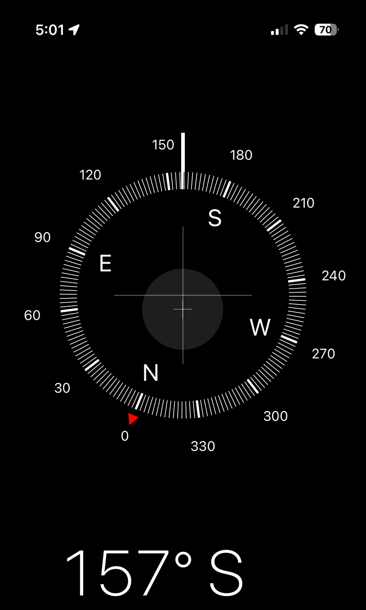
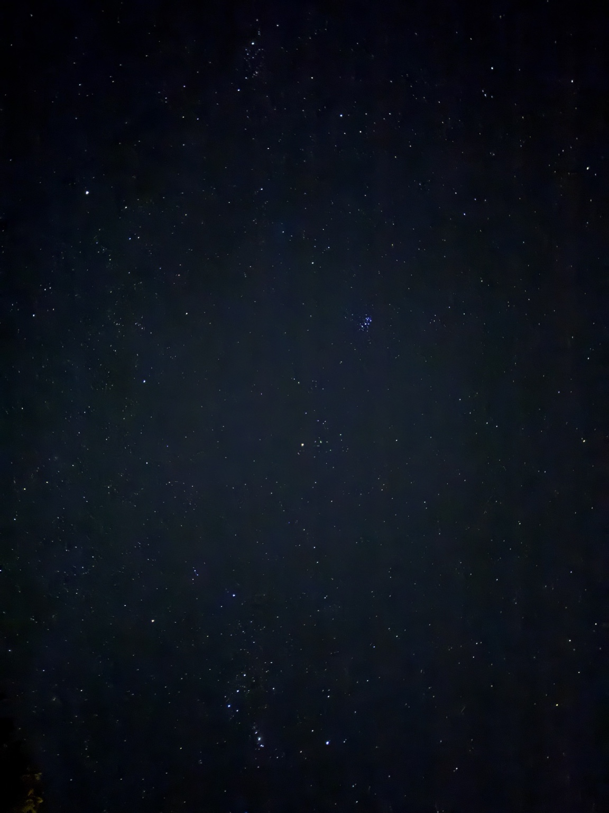
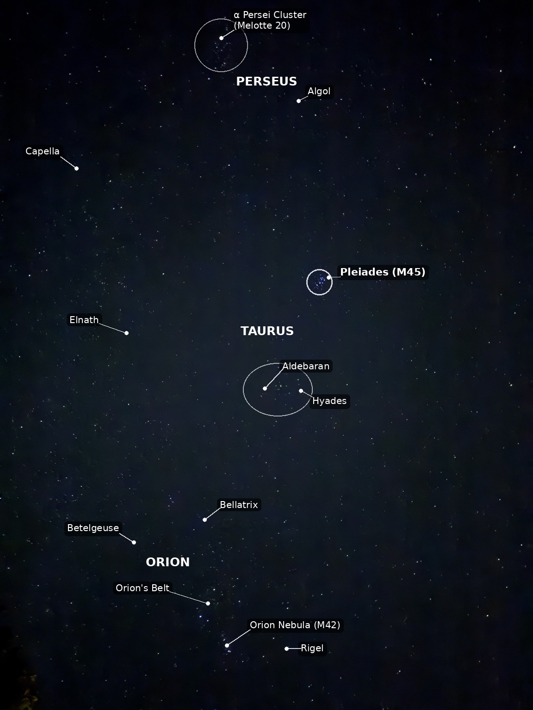
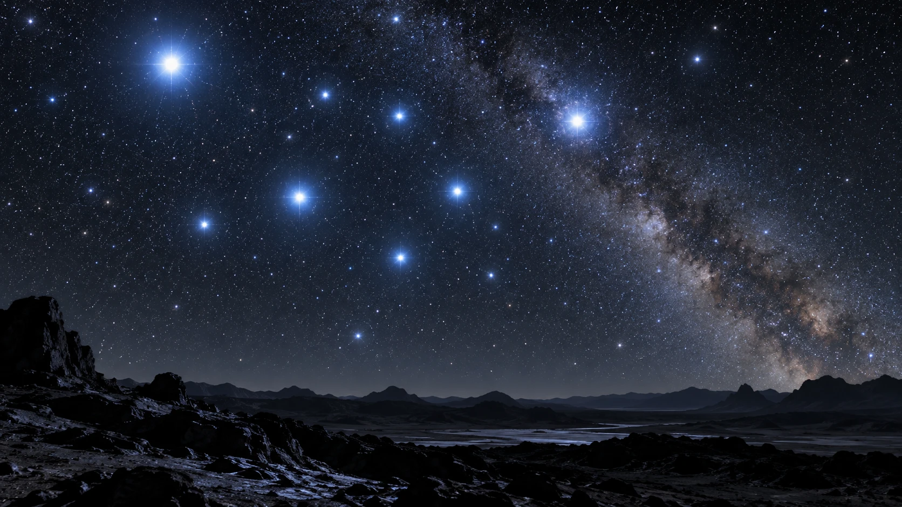

## RJ

There’s this meme online about people asking about stars and constellations and the answer is always the Pleiades. Do you know what I’m talking about and can you explain it?

## ChatGPT

Yes — you’re talking about the **“It’s always the Pleiades”** joke, which is especially common on Reddit astronomy/stargazing communities.

The basic gag is that someone posts a phone photo of a conspicuous little knot of stars and asks, “What constellation is this?” or “What are these weird stars?” And with absurd frequency, the answer really is **the Pleiades**. People now reflexively reply “r/ItsAlwaysPleiades” or “It’s always Pleiades.” There are posts where commenters joke about “resetting the counter” to zero hours since somebody last asked about them.<sup class="cite"><a href="https://www.reddit.com/r/askastronomy/comments/1h1bd9q" title="Post in r/askastronomy">1</a></sup>

There are a few reasons it happens so much. The Pleiades — also called the **Seven Sisters** or **M45** — are a compact open star cluster in Taurus. They’re bright enough to see with the naked eye, but unlike most familiar constellations, they look immediately **weird and distinctive**: several fairly bright stars packed into an area only a couple Moon-widths across. A casual observer notices them and thinks, essentially, *“Whoa, stars don't normally look bunched together like that.”* So they photograph them.<sup class="cite"><a href="https://www.reddit.com/r/Stargazing/comments/1iijk2k" title="Post in r/Stargazing">2</a></sup>

Phone cameras have made the phenomenon even stronger. Modern night-mode processing can pull out stars that your eye only barely noticed, while the Pleiades are compact enough to remain recognizable in a handheld shot. Thus a huge fraction of “I randomly pointed my phone at the sky — what did I capture?” posts end up showing them. One 2025 example has exactly that sequence: someone on a night shift photographs an unusually orderly-looking cluster, asks what it is, and immediately gets “Pleiades / r/itsalwayspleiades.”<sup class="cite"><a href="https://www.reddit.com/r/Stargazing/comments/1no62zp" title="Post in r/Stargazing">3</a></sup>

There’s another funny component: **people often call them a constellation, but technically they aren’t one.** They’re a real physical star cluster — hundreds of stars born from roughly the same molecular cloud — whereas a constellation is primarily a region/pattern on the celestial sphere. The Pleiades happen to lie within the constellation **Taurus**.

And the meme has become self-perpetuating. People who know essentially no astronomy start hanging around these communities and eventually discover that they can correctly identify one celestial object with astonishing reliability. One commenter basically describes exactly that: after repeatedly seeing the posts, they find themselves yelling “PLEIADES!” despite knowing almost nothing else about astronomy.<sup class="cite"><a href="https://www.reddit.com/r/Stars/comments/1h6reht" title="Post in r/Stars">4</a></sup>

So the meme is essentially astronomy’s version of:

> **“What is this?”**  
> *posts tiny clump of stars*  
> **“Pleiades.”**  
> **“How did you know?”**  
> **“Because it’s always the Pleiades.”**

There’s even a closely related astronomy joke, **“It’s always Venus,”** for people reporting a mysterious extraordinarily bright “star/UFO” around sunrise or sunset. The Pleiades version is particularly good because the ridiculous answer is so often literally correct.

<ol class="sources">
<li><a href="https://www.reddit.com/r/askastronomy/comments/1h1bd9q">Post in r/askastronomy</a> · Reddit</li>
<li><a href="https://www.reddit.com/r/Stargazing/comments/1iijk2k">Post in r/Stargazing</a> · Reddit</li>
<li><a href="https://www.reddit.com/r/Stargazing/comments/1no62zp">Post in r/Stargazing</a> · Reddit</li>
<li><a href="https://www.reddit.com/r/Stars/comments/1h6reht">Post in r/Stars</a> · Reddit</li>
</ol>

## RJ

The sky is exceptionally clear tonight. It looks from where I’m standing that the Pleiades are almost at the zenith. Based on my location and the current date and time, can you figure out approximately how dark the sky is and figure out what else I might be able to see from this exact spot?



## ChatGPT

Yes. Using the coordinates shown in your screenshot, **[exact coordinates removed]**, and the current time of about **5:05 a.m. EDT on September 16**, this is an unusually good observing window.

The important part is that it is **genuinely astronomical night right now**. I calculate the Sun at about **22.6° below the horizon**. At your exact longitude, astronomical dawn—when the Sun reaches −18°—starts at roughly **5:31 a.m.** Nautical twilight follows around **6:04**, with sunrise about **7:02**. The Moon is also completely out of the picture: it set last night around 10 p.m. So at the moment there is essentially **zero moonlight and zero twilight contamination**.<sup class="cite">1</sup>

In other words, **right now is about as naturally dark as your sky can get**. The remaining limitation is artificial light pollution and atmospheric transparency. I can't get a trustworthy exact SQM reading from the interactive light-pollution atlas through search, so I wouldn't pretend to have a precise number, but your position looks roughly like a **Bortle 4–5 transition sky** rather than either a city sky or pristine wilderness—very approximately **~20–21 mag/arcsec² at the zenith** under a good clear night. These atlas values are modeled from satellite light data rather than measured at your yard, so that range is more defensible than a single number.<sup class="cite"><a href="https://lightpollutionmap.app/" title="Light Pollution Map">2</a></sup>

And your impression of the Pleiades is almost exactly right. They're **very high, but not quite at zenith**. At about 5:05 I get:

**Pleiades: altitude ≈74°, azimuth ≈163° (south-southeast).**

Your Compass screenshot says you're facing **157°**, which is almost dead-on. So if you're standing where you took that screenshot and looking steeply upward, you're basically looking straight toward M45. The actual zenith is currently in **Perseus**: **Algol is only about 4° from straight overhead**, and Mirfak is about 10° from it. That's probably contributing to the feeling that that entire Pleiades/Perseus part of the sky is directly above you.

Here's what your sky should look like right about now; these positions are calculated for your screenshot coordinates at ~5:05 a.m.:

| Object | Where to look | Altitude | What you should see |
|---|---|---:|---|
| **Pleiades (M45)** | SSE, 163° | **74°** | Extremely obvious naked-eye cluster |
| **Algol / Perseus** | Almost overhead | **86°** | Algol essentially at zenith |
| **Mirfak / Perseus** | Almost due north overhead | **80°** | Bright heart of Perseus |
| **Aldebaran + Hyades** | SE, 142° | **63°** | Orange Aldebaran beside the big V-shaped Hyades |
| **Capella** | ENE, 63° | **69°** | Very bright yellow-white star |
| **Orion / Betelgeuse** | SE, 124° | **44°** | Orion should be spectacular now |
| **Orion Nebula (M42)** | SE, 139° | **36°** | Naked-eye fuzzy “star” in the Sword; excellent in binoculars |
| **Sirius** | ESE, 130° | **17°** | Brilliant, low but rising |
| **Mars** | Almost due east, 87° | **35°** | Distinctly orange point |
| **Jupiter** | ENE, 78° | **12°** | Very bright; recently risen |
| **Saturn** | SW, 234° | **40°** | Steady yellowish point |
| **Uranus** | SE, 146° | **70°** | Binocular target; only **~7° from the Pleiades** |
| **Andromeda Galaxy (M31)** | WNW, 287° | **59°** | Excellent binocular target; possibly naked-eye |
| **Double Cluster** | NNW, 334° | **69°** | Gorgeous in binoculars; possibly a naked-eye haze |
| **M33 / Triangulum Galaxy** | WSW, 258° | **65°** | Very difficult naked-eye test; binoculars much easier |

The planetary situation is particularly nice. [Your town]'s ephemeris has **Mars rising at 1:56 a.m., Jupiter at 3:58 a.m., Saturn having culminated around 2:30 a.m., and Uranus high in the morning sky**.<sup class="cite">1</sup>

There's also something rather more unusual worth mentioning **tonight specifically**: **zodiacal light**. We're in the best Northern Hemisphere season for the *morning* zodiacal light, because the ecliptic rises steeply before dawn near the September equinox. This particular week, September 11–18, has been highlighted as especially favorable because there is little moon interference. With your Moon already set, clear conditions, and another ~25 minutes before astronomical twilight begins, you could potentially see a **very broad, faint triangular cone of light rising from the eastern horizon**—the so-called “false dawn.”<sup class="cite"><a href="https://www.space.com/stargazing/ive-chased-the-false-dawn-for-years-this-is-the-week-to-find-and-photograph-it" title="I&#x27;ve chased the &#x27;false dawn&#x27; for years — this is the week to find and photograph it">3</a></sup>

That is fundamentally different from the coming real dawn: zodiacal light follows the ecliptic upward and looks like an enormous diffuse wedge rather than a uniform brightening of the eastern horizon.

One other thing I'd look for conceptually in judging just how good your sky is tonight is **M31**. At your position it's beautifully placed, nearly 60° up in the WNW. If, after your eyes are fully dark-adapted, you can make out the Andromeda Galaxy as a small diffuse patch *without optical aid*, then the actual sky at your spot tonight is probably toward the darker end of that Bortle 4–5 estimate. If M31 disappears naked-eye but leaps out in binoculars, that would be more consistent with the brighter end.

And yes: **this is absolutely one of those “go outside right now” skies.** You're catching the autumn/winter sky high overhead, the summer planets still available, no Moon, no astronomical twilight yet, and unusually clear air all at once.

<ol class="sources">
<li>Night sky in [your town] · timeanddate.com [link removed]</li>
<li><a href="https://lightpollutionmap.app/">Light Pollution Map</a> · lightpollutionmap.app</li>
<li><a href="https://www.space.com/stargazing/ive-chased-the-false-dawn-for-years-this-is-the-week-to-find-and-photograph-it">I've chased the 'false dawn' for years — this is the week to find and photograph it</a> · Space.com</li>
</ol>

## RJ

Just while I was listening to text-to-speech on that last response, I saw two meteors near Perseus. So I guess we're still traveling through the tail of that comet? Or could those be from something else?

## ChatGPT

Very possibly — but not from the **August Perseids** you’re thinking of.

Those classic Perseids, produced by debris from **Comet 109P/Swift–Tuttle**, are essentially finished by now; their normal activity ends in late August.<sup class="cite"><a href="https://amsmeteors.org/meteor-showers/meteor-shower-calendar/" title="2026/2027 Meteor Shower Calendar">1</a></sup>

But there is a separate, much weaker shower happening **right now** called the **September ε-Perseids**. It is active roughly **September 5–21**, peaked around September 9, and its radiant is in central Perseus, currently only a couple of degrees from **Algol**. That is almost exactly the part of the sky you were just looking at near the zenith.<sup class="cite"><a href="https://www.emeteornews.net/2026/09/11/meteor-activity-outlook-for-12-18-september-2026/" title="Meteor Activity Outlook for 12–18 September 2026">2</a></sup>

So the funny answer is: you may actually have just seen **two September epsilon Perseids**.

They are **not leftovers from Swift–Tuttle**. Despite the similar name, this is a different meteoroid stream. Its parent body has never been firmly identified; orbital studies indicate it is probably debris from an **unknown long-period comet**, perhaps with an orbital period on the order of a thousand years.<sup class="cite"><a href="https://www.aanda.org/articles/aa/pdf/2019/09/aa35900-19.pdf" title="September epsilon Perseids observed by the Czech Fireball Network">3</a></sup>

There is one important catch. Seeing a meteor *in Perseus* doesn't by itself make it an ε-Perseid. Shower membership is determined by the **direction of travel**: extend the meteor's streak backward across the sky. If it points back toward the radiant near Algol, around RA **3h24m, Dec +40°** tonight, it's a good candidate. If its path points somewhere else, it was probably a sporadic meteor.<sup class="cite"><a href="https://www.emeteornews.net/2026/09/11/meteor-activity-outlook-for-12-18-september-2026/" title="Meteor Activity Outlook for 12–18 September 2026">2</a></sup>

And sporadics are actually quite plausible tonight. The current American Meteor Society outlook estimates that around **10 sporadic meteors per hour** can occur during the final hour before dawn from a genuinely dark mid-northern site. The ε-Perseids themselves are currently expected at **less than one per hour** because we're a week past their maximum.<sup class="cite"><a href="https://www.emeteornews.net/2026/09/11/meteor-activity-outlook-for-12-18-september-2026/" title="Meteor Activity Outlook for 12–18 September 2026">2</a></sup>

So seeing **two meteors within a few minutes** is a nice little run. If both were **very fast**—more like a sudden needle-streak than a leisurely glide—and their tracks radiated away from roughly Algol, that strengthens the ε-Perseid identification considerably. These hit the atmosphere at about **64 km/s**, so they're among the very fast meteor populations.<sup class="cite"><a href="https://www.emeteornews.net/2026/09/11/meteor-activity-outlook-for-12-18-september-2026/" title="Meteor Activity Outlook for 12–18 September 2026">2</a></sup>

Also, technically we aren't passing through a comet's *tail* when we see a meteor shower. We're crossing a **stream of old comet debris spread along the comet's orbit**. The comet itself can be nowhere remotely nearby when Earth plows through that ribbon of dust.

<ol class="sources">
<li><a href="https://amsmeteors.org/meteor-showers/meteor-shower-calendar/">2026/2027 Meteor Shower Calendar</a> · American Meteor Society</li>
<li><a href="https://www.emeteornews.net/2026/09/11/meteor-activity-outlook-for-12-18-september-2026/">Meteor Activity Outlook for 12–18 September 2026</a> · eMeteorNews</li>
<li><a href="https://www.aanda.org/articles/aa/pdf/2019/09/aa35900-19.pdf">September epsilon Perseids observed by the Czech Fireball Network</a> · Astronomy &amp; Astrophysics, 2019 (PDF)</li>
</ol>

## RJ

I don't have my tripod, but I still think I got pretty good shot. Can you identify and annotate anything in this?



## ChatGPT

Yes — and that is a remarkably good handheld shot. There’s enough structure here to identify a substantial part of the winter sky.

I made an annotated copy here:



The strongest identifications are **the Pleiades (M45), the Hyades with Aldebaran, Orion’s Belt, Betelgeuse, Bellatrix, Rigel, and even the Orion Nebula (M42)**. Capella and Elnath are also clear.

The especially neat part is the top of the frame: that rich patch of stars is the **Alpha Persei Cluster (Melotte 20)** around Mirfak, with **Algol** nearby. So you really did photograph the Perseus region where you had just been seeing meteors.

And your phone actually picked up **M42** as more than just a point source in Orion’s Sword. Considering this was handheld, the amount of stellar detail is pretty extraordinary.

I don't see an unmistakable meteor trail in this particular exposure, though. The faint streaky-looking structure elsewhere appears more consistent with the phone's long-exposure processing, slight hand movement, and atmospheric/cloud structure than a discrete meteor.

The photo also makes the earlier “it’s always the Pleiades” conversation pretty funny: they're sitting there almost dead center, looking absurdly conspicuous.

## RJ

I'm watching Betelgeuse. I just think how cool it would be if it went supernova while I was watching.

## ChatGPT

That would be one of the most extraordinary things a person could ever happen to witness.

And there’s a wonderfully strange wrinkle: if Betelgeuse were to go supernova while you’re watching tonight, the star itself would actually have exploded **hundreds of years ago**. Betelgeuse is roughly 500–650 light-years away, so you’d just be the person standing there when the news finally arrived.

It also probably wouldn’t look like a sudden Hollywood-style flash. A core-collapse supernova would likely brighten dramatically over **hours to days**. Betelgeuse could become comparable to the **full Moon in apparent brightness**, though concentrated into a point, and it could remain conspicuous in daylight for weeks. It would cast faint shadows at night.

The eerie part is that, to your eyes, there may be essentially no warning. Professional neutrino detectors could potentially see a burst **hours before the visible light really ramps up**, because neutrinos escape the collapsing core almost immediately while photons have to fight their way out through the star.

So you could, in principle, be staring at ordinary orange Betelgeuse, go inside, check the news later, and discover that neutrino observatories were suddenly lighting up because the star had just died.

Astronomically, Betelgeuse is absolutely in its late-life phase, but “soon” for a red supergiant can still mean **tens or hundreds of thousands of years**. There’s no evidence that it’s specifically about to explode now.

Still, every time you look at it, there is a nonzero chance that the photons reaching your eye are among the last ones from Betelgeuse as a normal star. That is a pretty great thing to think about while you’re standing there watching it.

## RJ

Oh, I went and got my camp chair already. I haven't seen a sky this good in a long time. One thing I find so strange about looking up at the sky is how statically 2D it feels in some sense. I have binoculars tonight too, and when you look through the binoculars, you can see more of the 3D structure suddenly. But still, we're always locked into this perspective, and I've always wanted to have kind of a split-screen map that could show what you see when you look up at the night sky on one panel, and on the other show what it looks like from the perspective of looking down at the spiral of the Milky Way from a point in the void somewhere far above.

## ChatGPT

Yes — and there’s a really interesting reason the visualization you’re imagining would be so powerful.

What your eyes see is basically a **projection onto the inside of a sphere**. Every object gets reduced to two angular coordinates—where it is left/right and up/down—but its distance is mostly thrown away. Betelgeuse at roughly 500–650 light-years, the Pleiades around 440 light-years, and a much more distant background star can all look like neighboring pinpricks on the same black surface.

One subtle correction to the binocular experience: the binoculars aren't actually giving you measurable stellar stereopsis. The separation between your eyes is absurdly too small relative to stellar distances for that. What they *are* doing is giving you many more faint stars, revealing clusters and nebulosity, increasing contrast, and supplying your visual system with much richer structure. Your brain interprets that richer texture as depth. It's a very convincing kind of **pseudo-3D**, even though the stellar image entering each eye has effectively zero binocular parallax.

And your split-screen idea would expose exactly what the naked eye conceals.

I picture the left side as **“The Sky”**: essentially what you're seeing from that chair, with the horizon and celestial sphere. You could tap Betelgeuse, the Pleiades, Capella, Sirius, M42, etc.

The right side would be **“The Galaxy”**, seen face-on from above the Galactic north pole. Selecting Betelgeuse on the left would highlight its actual location on the right, with a line from the Sun to it. Select several stars and suddenly the familiar Orion shape would be revealed as something that **doesn't really exist in 3-D at all**—its stars are distributed at radically different distances.

There is one fascinating design problem, though. A literal full-galaxy view would almost defeat the purpose.

The Milky Way is roughly **100,000+ light-years across**, whereas nearly everything you're admiring naked-eye tonight is in a tiny neighborhood around us. The Pleiades are ~440 ly away; Betelgeuse ~hundreds; Sirius only 8.6; the Orion Nebula ~1,300. On a 100,000-light-year-wide map, all of those would essentially pile on top of the **“You are here”** dot.

So I think the right panel actually wants **two simultaneous scales**:

**Milky Way → Solar Neighborhood**

A small full-galaxy view establishes where the Sun sits—partway out in the disk, in the Orion Spur—and then a magnified window perhaps **3,000–5,000 light-years across** shows the actual geometry of the things visible in the left-hand sky.

That's where it would become amazing. You could draw a ray from your position through each apparent point on the celestial sphere and then show where along that ray the object actually lies.

For example, take **Orion**. From your chair it looks approximately like this:

```text
            Betelgeuse •
                        \
             •  •  •     ← Belt
                        \
                     • Rigel
```

A familiar, coherent figure.

Rotate the coordinate system into actual Galactic space, however, and those stars aren't arranged on a flat hunter-shaped sheet. Some are hundreds of light-years nearer or farther than others. You're looking down a set of sightlines and **perspective happens to collapse them into Orion**.

That's the part I think would scratch the itch you're describing: not simply a planetarium, but a **projection/unprojection machine**.

You could even have a slider:

**Earth view ←————→ Galactic view**

As you drag it, the celestial sphere slowly deforms into physical 3-D positions. Constellations would stretch, shear and dissolve. Clusters like the **Pleiades** would behave completely differently: instead of dissolving, the stars would remain a genuine group, because unlike a constellation they're physically associated. That would make the distinction between *constellation* and *star cluster* immediately intuitive in a way a textbook explanation never quite does.

And then there are objects like M31. On the sky it's just another little patch. In the Galactic-scale visualization, you would have to **zoom out by another three orders of magnitude**, and suddenly the whole Milky Way becomes the little object.

There's one further scientific wrinkle I'd want the visualization to make explicit: our usual **face-on picture of the Milky Way is itself a reconstruction**. Nobody has flown above the Galactic disk and photographed it. We're embedded inside it, behind enormous amounts of dust. The spiral-arm geometry comes from mapping stars, gas, masers, radio observations, Gaia astrometry, and other measurements. So the second panel could distinguish:

**measured object positions** from **modeled/reconstructed Galactic structure**.

That actually makes it cooler rather than less cool.

And tonight you're sitting in an unusually good place to feel why this is necessary. You can look from Betelgeuse to Aldebaran to the Pleiades to Perseus and your visual system insists, *“Those objects are all painted onto that surface up there.”*

They aren't.

You're standing inside a sparse three-dimensional swarm of stars, looking through thousands of light-years of it, and your retina is flattening the entire thing into a dome.

That disconnect between **what the universe is** and **the projection our senses give us** is one of the strangest things about looking at a really dark sky.

## RJ

What you described is basically exactly what I had in mind. But it's hard to believe that it hasn't been built already. If we could keep it faithful, using actual star maps and astronomical data, it seems appropriate to give it to Astra as a task. Everything we see as individual stars in the night sky is in the galaxy. But we can see something of the Magellanic Clouds and the Andromeda Galaxy, right? You mentioned that earlier. And I'm pretty sure I've seen them before, with binoculars at least. That kind of makes the scale of the ultimate galactic view even more distorted. But yeah, I always knew that the constellations were kind of just an arbitrary human grouping by convention to make sense of the shapes and help as a mnemonic for all the practical purposes we used to derive from the stars in terms of navigation and other things.

## ChatGPT

Yes — and I checked, because your reaction was basically mine: **pieces of this absolutely exist, but I don’t see a mainstream tool that quite does the exact thing you’re describing.**

The closest serious existing foundation is **Gaia Sky**. It is an open-source real-time 3D astronomy viewer built around scientific catalogs, including Gaia DR3, and it can render enormous numbers of stars in their actual 3D positions. Gaia DR3 itself provides sky position, parallax, and proper motion for about **1.46 billion sources**, so the raw astrometric basis for doing this faithfully is very much available.<sup class="cite"><a href="https://gaiasky.space/" title="Gaia Sky">1</a></sup>

**WorldWide Telescope** is another close cousin. It explicitly has an Earth-sky mode and a **3D Universe** mode in which you can pull away from the Solar System into nearby stars, the Milky Way, and other galaxies; its rendering engine is also reusable for custom web applications.<sup class="cite"><a href="https://worldwidetelescope.org/use/everyone/" title="WorldWide Telescope: WWT for the Rest of Us">2</a></sup>

There are even research/data-visualization tools such as **glue** built around “linked views,” where selecting something in one projection highlights the corresponding thing in another. That interaction model is almost exactly the conceptual trick we want.<sup class="cite"><a href="https://glueviz.org/" title="glue: multi-dimensional linked-data exploration">3</a></sup>

But the specific experience you described — **Earth sky on the left, true spatial position on the right, both continuously linked so that a constellation can literally unfold into its real 3D geometry** — appears to be a different product idea. I found hobby projects with dual 2D/3D sky views, but those generally mean two representations of the *celestial sphere*, not “apparent sky versus Galactic physical space.”<sup class="cite"><a href="https://github.com/NicBeans/starmap" title="NicBeans/starmap">4</a></sup>

And yes, your extragalactic point makes the scale problem much more interesting.

For an observer in [your town], **Andromeda absolutely is available**. M31 is about **2.5 million light-years away**, apparent magnitude ~3.1, and NASA describes it as readily visible to the unaided eye from a genuinely dark site. Binoculars make it much easier.<sup class="cite"><a href="https://science.nasa.gov/mission/hubble/science/explore-the-night-sky/hubble-messier-catalog/messier-31/" title="Messier 31 (The Andromeda Galaxy)">5</a></sup>

The **Magellanic Clouds are different**, though: you cannot see either one from West Virginia. They're so far south on the celestial sphere that they never rise from latitude ~39.5° N. The Large and Small Magellanic Clouds are roughly **163,000 and 200,000 light-years away**, respectively, and are conspicuous naked-eye objects from suitable Southern Hemisphere locations.<sup class="cite"><a href="https://www.nasa.gov/universe/nasas-swift-produces-best-ultraviolet-maps-of-the-nearest-galaxies/" title="NASA&#x27;s Swift Produces Best Ultraviolet Maps of the Nearest Galaxies">6</a></sup> So if you remember seeing them, it would have been during travel considerably farther south. You may also be remembering Andromeda or, under an unusually dark sky, possibly **M33**, the Triangulum Galaxy.

That suggests that the right-hand visualization really shouldn't have one “ultimate zoom level.” It needs a hierarchy:

**Solar neighborhood → Milky Way → Local Group.**

At perhaps a few thousand light-years across, you can meaningfully compare Sirius, Betelgeuse, the Pleiades, Orion's stars, M42, etc. Zoom out to ~100,000 light-years and those all collapse into a tiny region around the Sun while the Milky Way structure becomes meaningful. Zoom out again to a few million light-years and suddenly the **Magellanic Clouds, Andromeda, Triangulum, and the Milky Way satellite population** make sense spatially.

That also gives us a clean way to stay scientifically faithful rather than cheating the geometry with a logarithmic scale. The geometry could remain **linear at every level**, while the UI transitions between nested scales.

And what you said about constellations is exactly the conceptual payoff. They aren't arbitrary in the sense of being meaningless; they're extremely useful **angular patterns**. Humans needed a coordinate/mnemonic system for a spherical sky long before anyone knew stellar distances. They're useful for orientation, calendars, navigation, identifying regions, and handing sky knowledge from person to person.

But they're arbitrary in the deeper spatial sense. The figure exists because of **our particular viewpoint**.

A cluster such as the Pleiades would survive the transition. Orion would not.

That difference could become the centerpiece of the whole application. Click **Pleiades**, drag the view away from Earth, and the little group remains a recognizable physical concentration because its stars really are associated. Click **Orion**, and the familiar hunter gets pulled apart through hundreds of light-years of depth.

There's another reason Astra is well suited to this: we don't really need it to invent an astronomical model. The scientific infrastructure already exists. A good implementation could use Gaia astrometry for stars, established deep-sky catalogs for clusters/nebulae/galaxies, standard equatorial-to-Galactic coordinate transformations, and a modeled Milky Way layer only where direct observations stop defining the structure. Gaia's nearby-star work alone maps the solar neighborhood with very high precision out to **100 pc / 326 ly**.<sup class="cite"><a href="https://www.cosmos.esa.int/web/gaia/edr3-gcns" title="Gaia Catalogue of Nearby Stars (Gaia EDR3)">7</a></sup>

So the task isn't “make a cool-looking galaxy simulator.”

It's much more precise:

**Build an interactive visual explanation of how the real 3D universe around us projects onto the 2D night sky.**

That is a much stronger idea.

<ol class="sources">
<li><a href="https://gaiasky.space/">Gaia Sky</a> · gaiasky.space</li>
<li><a href="https://worldwidetelescope.org/use/everyone/">WorldWide Telescope: WWT for the Rest of Us</a> · WorldWide Telescope</li>
<li><a href="https://glueviz.org/">glue: multi-dimensional linked-data exploration</a> · glueviz.org</li>
<li><a href="https://github.com/NicBeans/starmap">NicBeans/starmap</a> · GitHub</li>
<li><a href="https://science.nasa.gov/mission/hubble/science/explore-the-night-sky/hubble-messier-catalog/messier-31/">Messier 31 (The Andromeda Galaxy)</a> · NASA Science</li>
<li><a href="https://www.nasa.gov/universe/nasas-swift-produces-best-ultraviolet-maps-of-the-nearest-galaxies/">NASA's Swift Produces Best Ultraviolet Maps of the Nearest Galaxies</a> · NASA</li>
<li><a href="https://www.cosmos.esa.int/web/gaia/edr3-gcns">Gaia Catalogue of Nearby Stars (Gaia EDR3)</a> · ESA Cosmos</li>
</ol>

## RJ

One, what is the most distant object that can be viewed with the naked eye? And then what is the most distant object that can be viewed with binoculars from anywhere on Earth? And when you consider the Pleiades as a concentrated star cluster, where there's so many bright stars right there all together, and they really are closer in 3D space. How does that relate to the closest stars to us? So, like, what I'm wondering is if there were a planet orbiting one of the seven main stars that we typically see, even though the number varies a whole lot between how dark it is and how good your eyes are. If there were a planet orbiting one of those stars, how would their experience of the brightness of stars and the location of other stars in the sky on that planet be different than our own experience? Like, would it just be a scattering of specks like we see, with some minor change in apparent brightness? Or would stars that are much closer not really matter? Because at the scale of the Pleiades compared to what is truly local, such as Alpha Proxima and Centauri, I don't really know the scale of that, because there are so many other factors too when you think about it that come into play of what's visible. We hardly ever see Alpha Centauri, and we usually need binoculars for it, at least from where I am, even though it's the closest.

## ChatGPT

Yes. The Pleiades are almost the perfect thought experiment for disentangling **distance**, **intrinsic luminosity**, and the way our particular location creates the night sky.

For your first question, there are actually two very different answers to “most distant naked-eye object.” Among more-or-less permanent objects, **M31 Andromeda** at about 2.5 million light-years is the standard easy answer, while **M33, the Triangulum Galaxy**, at roughly 3 million light-years can be seen without optical aid under exceptionally dark, transparent skies. There are even credible reports of **M81**, 11.6 million light-years away and magnitude ~6.9, being detected naked-eye by unusually skilled observers under extraordinary conditions, although its low surface brightness makes that much more contentious than M31 or M33.<sup class="cite"><a href="https://skyandtelescope.org/online-gallery/m33-galaxy/" title="M33 Galaxy">1</a></sup>

But the record becomes ridiculous if transient objects count. **GRB 080319B**, a gamma-ray burst in 2008, briefly reached about magnitude 5–6 and could have been seen with an unaided human eye. Its light had traveled about **7.5 billion years** to reach us. For tens of seconds, something literally billions of light-years away was technically a naked-eye object.<sup class="cite"><a href="https://science.nasa.gov/image-detail/amf-f7c95234-c5c9-4bf7-a531-88d7d15c4f60/" title="Hubble Image of Gamma-Ray Burst 080319B">2</a></sup>

For binoculars, there isn't one clean record because “binoculars” can mean anything from little 8×25s to tripod-mounted **100 mm giant binoculars**. With ordinary good **10×50s**, galaxies at tens of millions of light-years are already possible under excellent skies. Experienced observers have detected Virgo Cluster members such as M84/M86/M87 through binoculars; those are roughly **52–60 million light-years away**.<sup class="cite"><a href="https://www.perezmedia.net/beltofvenus/archives/000390.html" title="M84 and M86 - The Heart of the Virgo Galaxy Cluster">3</a></sup>

Once you get into giant astronomy binoculars, things become almost absurd again. **3C 273**, the brightest quasar, is around magnitude 12.8–12.9 and is a challenge target for ≥70 mm giant binoculars under very dark skies. Depending on which cosmological distance definition you use, you're looking at roughly **2 billion-plus light-years**. So there isn't really an aperture-independent “farthest binocular object”; 3C 273 is a useful benchmark for just how far binocular-class instruments can be pushed.<sup class="cite"><a href="https://www.cloudynights.com/articles/column/phil-harrington-s/cosmic-challenge-quasar-3c-273-r3344/" title="Cosmic Challenge: Quasar 3C 273">4</a></sup>

Now the Pleiades part is where this gets really interesting.

The Pleiades are roughly **400–440 light-years from us**, about **100 times farther away than Alpha Centauri**. But the familiar bright portion of the Pleiades is only on the order of **13 light-years across**. So if you magically moved from Earth into the Pleiades, suddenly those stars that are presently ~400 light-years away would become your **immediate stellar neighborhood**—distances comparable to the 4–15 light-year separations between the Sun and our nearest stars. ESA gives the cluster as roughly 13 light-years across, and the seven familiar bright members are all luminous late-B-type stars.<sup class="cite"><a href="https://sci.esa.int/documents/34439/36575/1567253650186-6-exercise4-high.pdf" title="Measuring a Globular Star Cluster&#x27;s Distance and Age">5</a></sup>

And that last fact is crucial. Our neighborhood happens to contain lots of intrinsically unimpressive stars. **Proxima Centauri is the closest star to us and is still only about magnitude 11**, because it is a tiny red dwarf. Being close doesn't automatically mean bright.<sup class="cite"><a href="https://en.wikipedia.org/wiki/Proxima_Centauri" title="Proxima Centauri">6</a></sup>

The famous Pleiads are basically the opposite: **hot, blue-white, very luminous B stars**. So imagine a hypothetical planet around Alcyone and suppose another bright Pleiad that appears around magnitude 4 from Earth were only **10 light-years away** from that planet instead of ~440.

Brightness follows the inverse-square law, or in astronomical magnitudes:

\[
\Delta m = 5\log_{10}\left(\frac{d_2}{d_1}\right)
\]

Moving it from 440 ly to 10 ly makes it about **1,900 times brighter**, a change of ~8.2 magnitudes.

So:

**magnitude +4 → approximately magnitude −4.2.**

That's essentially **Venus-bright**.

Put the same star only 5 light-years away and it would be roughly **magnitude −5.7**—substantially brighter than Venus ever gets, though still enormously fainter than the full Moon at about −12.7.

So the answer to the picture you're forming is: **no, their sky would not merely look like ours with the dots moved around slightly.**

A hypothetical observer inside the Pleiades could have several intensely bright, blue-white stars scattered around the sky, potentially Venus-bright or brighter. Some could be easily visible in daylight. Under a dark sky, the brightest could potentially cast very faint shadows. They would still look like **points**, though—not little suns with discernible disks. Even a few light-years away, stellar angular diameters are far below naked-eye resolution.

Meanwhile, the rest of the stellar sky would still look broadly like a field of specks. That's because moving 440 light-years matters enormously for a star 5, 50, or 500 light-years away, but matters progressively less for stars thousands or tens of thousands of light-years away.

And here's a particularly good way to make the scale intuitive:

From the Pleiades, **our Sun would disappear**.

The Sun's absolute visual magnitude is about +4.8. Put it ~440 light-years away and it would appear at around **magnitude +10.5**. That's several magnitudes below naked-eye visibility. An astronomer living on your hypothetical Pleiades planet could point a decent telescope in our direction and locate the Sun, but there would be absolutely nothing visually special about it.

Likewise, Alpha Centauri would lose its privileged status. Its significance to us is almost entirely because **we happen to live next door to it**. Move the observer 400+ light-years away, and Alpha Centauri becomes just another faint star.

That is exactly the phenomenon your split-screen visualization could make visceral: **the “important” stars of the terrestrial sky aren't necessarily important objects in Galactic space.** A lot of the night sky is a map of *our location*, not a map of intrinsic astronomical importance.

There's also one correction to something you said that actually reinforces your point. From **[your town]**, you have never seen Alpha Centauri—not even with binoculars. Its declination is about **−60°50′**. At your latitude near 39.5° N, even at its highest possible point it remains about **10° below your southern horizon**. Where it *is* visible, Alpha Centauri A+B is extremely conspicuous and naked-eye bright; it's one of the brightest stellar objects in the entire sky. **Proxima Centauri**, the actual nearest individual star, is the faint one at roughly magnitude 11 and requires optical aid.<sup class="cite"><a href="https://kiwix.starmango.org/content/wikipedia_en_all_maxi_2024-01/A/Alpha_Centauri" title="Alpha Centauri">7</a></sup>

So there are really three wonderfully different examples sitting here:

**Proxima:** only 4.25 ly away, yet invisible naked-eye because it's intrinsically feeble.

**Pleiades B stars:** ~400+ ly away, yet obvious naked-eye because they're tremendously luminous.

**M33:** ~3,000,000 ly away, yet potentially naked-eye because you're not seeing one star at all—you're receiving the combined light of **billions of stars**.

And then GRB 080319B blows the whole intuition apart by saying, “Fine, how about one catastrophic event from **7.5 billion light-years away**?”

That's why “how far can I see?” turns out not to have much relationship to “what can I see?” without knowing what kind of object is producing the photons.

<ol class="sources">
<li><a href="https://skyandtelescope.org/online-gallery/m33-galaxy/">M33 Galaxy</a> · Sky &amp; Telescope</li>
<li><a href="https://science.nasa.gov/image-detail/amf-f7c95234-c5c9-4bf7-a531-88d7d15c4f60/">Hubble Image of Gamma-Ray Burst 080319B</a> · NASA Science</li>
<li><a href="https://www.perezmedia.net/beltofvenus/archives/000390.html">M84 and M86 - The Heart of the Virgo Galaxy Cluster</a> · Belt of Venus</li>
<li><a href="https://www.cloudynights.com/articles/column/phil-harrington-s/cosmic-challenge-quasar-3c-273-r3344/">Cosmic Challenge: Quasar 3C 273</a> · Cloudy Nights</li>
<li><a href="https://sci.esa.int/documents/34439/36575/1567253650186-6-exercise4-high.pdf">Measuring a Globular Star Cluster's Distance and Age</a> · ESA/ESO Astronomy Exercise Series (PDF)</li>
<li><a href="https://en.wikipedia.org/wiki/Proxima_Centauri">Proxima Centauri</a> · Wikipedia</li>
<li><a href="https://kiwix.starmango.org/content/wikipedia_en_all_maxi_2024-01/A/Alpha_Centauri">Alpha Centauri</a> · Wikipedia, January 2024 copy on a Kiwix mirror</li>
</ol>

## RJ

Would I have been able to see Alpha Centauri from Bogota? From Florida? And are you able to generate a visual of what the hypothetical night sky would look like from a planet orbiting the star in the Pleiades that you mentioned? It’s twilight now and the most of the stars are disappearing fast.

## ChatGPT

```reasoning worked="47s"
**Visualizing a hypothetical sky**

I’m envisioning a realistic night-sky illustration from a planet near a Pleiades star: a dark landscape, brilliant blue-white neighboring stars, a dense stellar cluster, and a Milky Way without familiar Earth constellations.
```



*[Editor’s note: ChatGPT replied with the image alone. Its reasoning summary was copied from the ChatGPT iPhone app, which shows it; the exported transcript doesn’t include it.]*

## RJ

That’s a cool image. Can you answer my questions about Alpha Centauri though?

## ChatGPT

Yes — **Bogotá, definitely. Florida, only from the southern part of the state, and even there it hugs the horizon.**

Alpha Centauri A+B has a declination of about **−60.8°**, so how high it can climb depends almost entirely on your latitude.

- **Bogotá (~4.7° N):** at culmination Alpha Centauri gets about **24.5° above the southern horizon**. That’s quite observable. It would look like a very bright single star to the naked eye, around magnitude **−0.3**. If you’ve spent clear nights in Bogotá with a decent southern view, it is entirely plausible that you’ve seen it without realizing what it was.
- **Miami (~25.8° N):** only about **3.4° above the horizon** at its highest.
- **Key West (~24.6° N):** about **4.6° high**.
- **Tampa (~28° N):** only about **1.2° high** — theoretically visible, but usually fighting haze, trees, buildings, and atmospheric extinction.
- **Orlando (~28.5° N):** less than **1° high**, essentially a horizon-skimming challenge.
- North of about **29.2° N**, Alpha Centauri never geometrically rises at all. So around Gainesville/Jacksonville, no.

That boundary follows directly from

\[
h_{\max}=90^\circ-|\phi-\delta|
\]

where \(\phi\) is your latitude and \(\delta\approx-60.8^\circ\) for Alpha Centauri.

So if your memory is of seeing a very bright southern star from **Bogotá**, Alpha Centauri is a realistic candidate. From **South Florida**, also possible, but much harder because it's buried in the worst part of the atmosphere.

And one distinction that matters: **Alpha Centauri A and B together are extremely bright**. The faint nearby star we were talking about is **Proxima Centauri**, which is the closest individual star to the Sun but only about magnitude +11. Proxima sits a little over 2° away from Alpha Centauri A/B on the sky and is invisible to the naked eye.

From [your town], neither binoculars nor a telescope can help with Alpha Centauri A/B, because the whole system stays roughly **10° below your horizon**. The Earth itself is in the way.

## RJ

Ok, I’m done for now with searching for some heavenly connection to the starry dynamo in the machinery of night. Night, it is no more.

## ChatGPT

A fitting place to stop. And excellent Ginsberg deployment.

The starry dynamo hasn’t gone anywhere; the Sun has just flooded the detector and washed the whole projection out. After a night of Pleiades, Perseus meteors, Betelgeuse, Orion, and trying to mentally unfold the celestial sphere into the actual Galaxy, **“Night, it is no more”** feels about right.

Good morning, RJ.

